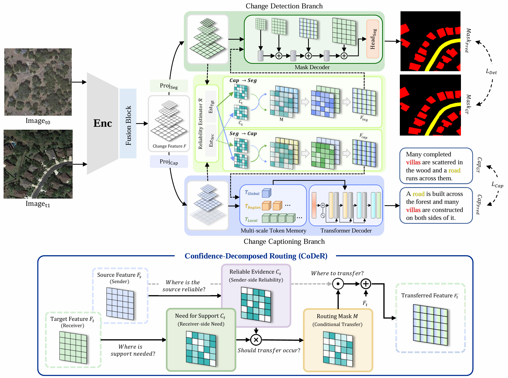
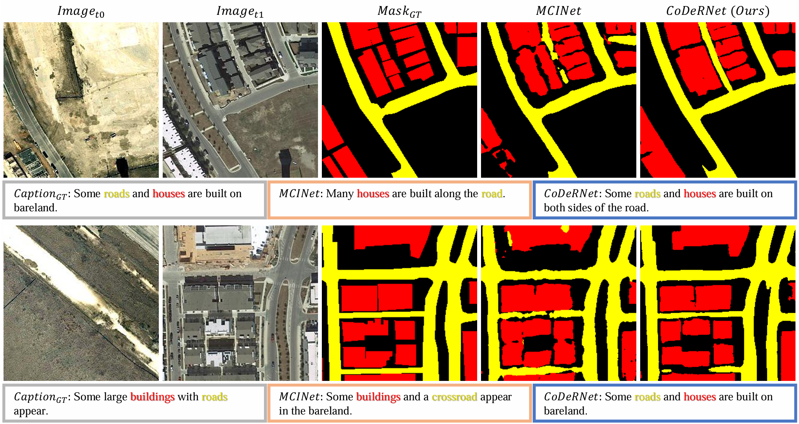

# CoDeRNet

Official PyTorch implementation of **CoDeRNet** (NeurIPS 2026) for joint change detection and change captioning on bi-temporal remote-sensing images.

<p align="center"></p>

<!-- A shared encoder and fusion block produce multi-scale change features, which are projected into a change-detection branch (mask decoder) and a change-captioning branch (multi-scale token memory + Transformer decoder). The two branches exchange information through **Confidence-Decomposed Routing (CoDeR)**: a receiver-side cue `C_t` marks where the target branch needs support, a sender-side cue `C_s` marks where the source branch is reliable, and their product `M = (1 - C_t) · C_s` gates a residual transfer `F_t' = F_t + M · g(F_s)`. Routing is applied in both directions (caption → detection at 1/8 scale, detection → caption at 1/16 scale). -->


## Installation

```bash
conda create -n codernet python=3.12 -y
conda activate codernet
pip install -r requirements.txt
# The METEOR scorer in eval_func/ relies on Java; install a JRE/JDK if not present.
```

The ImageNet-pretrained ConvNeXt-Base backbone is fetched through `timm` (Hugging Face Hub) the first time a model is built, so the first run needs network access.


## Datasets

Download links (used in our experiments):

- **LEVIR-MCI**: https://huggingface.co/datasets/lcybuaa/LEVIR-MCI/tree/main
- **WHU-CDC** : https://www.kaggle.com/datasets/yuehaozhang1109/whu-cdc/data

Data locations are passed to the scripts on the command line (`--data_folder`, `--list_path`, `--caption_json`); there are no built-in paths. Both loaders read a whole split into RAM at start-up (a few GB for the LEVIR-MCI training split).

### LEVIR-MCI (3-class change segmentation + captioning)

The archive contains the image pairs and one caption file:

```
<LEVIR_MCI_ROOT>/
├── images/
│   ├── train/{A, B, label}/*.png
│   ├── val/{A, B, label}/*.png
│   └── test/{A, B, label}/*.png
└── LevirCCcaptions.json
```

The split lists, the vocabulary and the per-image token files are not part of the archive. Generate them once with

```bash
python preprocess_levir_mci.py \
    --captions_json <LEVIR_MCI_ROOT>/LevirCCcaptions.json \
    --out_dir ./data/LEVIR_MCI
```

which writes

```
./data/LEVIR_MCI/                   # pass this folder as --list_path
├── train.txt, val.txt, test.txt    # image file names per split
├── vocab.json                      # {token: index}: <NULL>/<UNK>/<START>/<END> + words occurring > 5 times
└── tokens/<image>.txt              # the 5 tokenized captions of each image (--token_folder; default <list_path>/tokens)
```

Tokenization and vocabulary construction follow [Change-Agent](https://github.com/Chen-Yang-Liu/Change-Agent), so the generated files match the ones used for the released checkpoints (vocabulary size 468).

### WHU-CDC (binary change segmentation + captioning)

```
<WHU_CDC_ROOT>/
├── images/
│   ├── train/{A, B, label}/*.png
│   ├── val/{A, B, label}/*.png
│   └── test/{A, B, label}/*.png
└── whuCCcaptions.json           # caption JSON (one entry per image)
```

No preprocessing is needed: the split assignment, the captions and the vocabulary (all words of the training split) are read directly from `whuCCcaptions.json`.


## Training

The training entry handles both datasets through a single `--dataset` switch. Paper hyperparameters are the defaults (ConvNeXt-Base backbone, batch size 16 with gradient accumulation to an effective 64, Adam with learning rate 1e-4, 150 epochs, learning rate halved every 50 epochs); data paths, the optimizer schedule and runtime knobs are exposed on the CLI (`python train.py --help`). Training runs on a single GPU.

```bash
# LEVIR-MCI
python train.py \
    --dataset levir \
    --data_folder <LEVIR_MCI_ROOT>/images \
    --list_path   ./data/LEVIR_MCI

# WHU-CDC
python train.py \
    --dataset whu \
    --data_folder  <WHU_CDC_ROOT>/images \
    --caption_json <WHU_CDC_ROOT>/whuCCcaptions.json
```

Outputs are written to `./Results/levir_mci/` or `./Results/whu_cdc/` (change with `--savepath`):

```
Results/levir_mci/
├── train.log
├── best_epoch<N>.pth           # best checkpoint on the validation split
├── val_summary.txt
└── test_summary.txt
```

After the last epoch, the best checkpoint (selected on the validation split by the sum of mIoU/cIoU, BLEU-4 and CIDEr-D) is evaluated on the test split and the scores are written to `test_summary.txt`.

The released checkpoints were trained with a fixed seed in deterministic mode. `train.sh` wraps the calls above with exactly those settings:

```bash
bash train.sh levir <LEVIR_MCI_ROOT>/images ./data/LEVIR_MCI
bash train.sh whu   <WHU_CDC_ROOT>/images   <WHU_CDC_ROOT>/whuCCcaptions.json
# further options are passed through to train.py, e.g.
bash train.sh levir <LEVIR_MCI_ROOT>/images ./data/LEVIR_MCI --gpu_id 1 --savepath ./Results/run1/
```

which is equivalent to

```bash
export CUBLAS_WORKSPACE_CONFIG=:4096:8
export PYTHONHASHSEED=42
python train.py ... --deterministic --seed 42
```

Bit-exact reproduction additionally depends on the GPU model and the library versions (see `requirements.txt`).


## Evaluation

```bash
# LEVIR-MCI: print aggregate metrics only
python test.py \
    --dataset levir \
    --data_folder <LEVIR_MCI_ROOT>/images \
    --list_path   ./data/LEVIR_MCI \
    --checkpoint  ./checkpoints/levir_mci.pth

# LEVIR-MCI: also dump per-image predictions (colored mask PNGs + caption TXTs)
python test.py \
    --dataset levir \
    --data_folder <LEVIR_MCI_ROOT>/images \
    --list_path   ./data/LEVIR_MCI \
    --checkpoint  ./checkpoints/levir_mci.pth \
    --save_pred --result_path ./predict_result/

# WHU-CDC
python test.py \
    --dataset whu \
    --data_folder  <WHU_CDC_ROOT>/images \
    --caption_json <WHU_CDC_ROOT>/whuCCcaptions.json \
    --checkpoint   ./checkpoints/whu_cdc.pth
```

`--checkpoint` takes either a released checkpoint (see below; it defaults to `./checkpoints/<levir_mci|whu_cdc>.pth`) or a `best_epoch<N>.pth` written by `train.py`.

Reported metrics: `mIoU` (or `cIoU` for binary WHU-CDC), `binIoU`, `BLEU-1..4`, `METEOR`, `ROUGE-L`, `CIDEr-D`.

`binIoU` is the IoU of the merged change class: on LEVIR-MCI, road and building are merged into a single change class and scored against the background; on WHU-CDC it equals `cIoU`.

When `--save_pred` is set:

```
<result_path>/<ckpt_name>/
├── masks/<key>.png             # colored mask
└── captions/<key>_cap.txt      # "pred: ...\nref: ..."
```

Mask coloring:
- **LEVIR-MCI** — black (background) / yellow (road) / red (building)
- **WHU-CDC**  — black (background) / white (change)


## Pretrained Weights

The released checkpoints are hosted on [Google Drive](https://drive.google.com/drive/folders/1YMWuIE8tzl2eswk3lShkfugSN3tzbtXw).

| File | Dataset | Configuration |
|---|---|---|
| `levir_mci.pth` | LEVIR-MCI | ConvNeXt-Base, 3 classes, `--max_length 41` (defaults of `--dataset levir`) |
| `whu_cdc.pth`   | WHU-CDC   | ConvNeXt-Base, 2 classes, `--max_length 26` (defaults of `--dataset whu`) |

Place the files under `./checkpoints/`: `test.py` looks there by default (`levir_mci.pth` for `--dataset levir`, `whu_cdc.pth` for `--dataset whu`), and any other location can be passed with `--checkpoint`. Test-split results of the released checkpoints:

| Dataset | mIoU / cIoU | binIoU | BLEU-1 | BLEU-2 | BLEU-3 | BLEU-4 | METEOR | ROUGE-L | CIDEr-D |
|---|---|---|---|---|---|---|---|---|---|
| LEVIR-MCI | 87.79 (mIoU) | 83.07 | 87.25 | 79.42 | 72.26 | 66.27 | 41.08 | 76.36 | 141.79 |
| WHU-CDC   | 90.25 (cIoU) | 90.25 | 87.44 | 82.38 | 77.85 | 74.17 | 49.04 | 83.58 | 163.37 |


## Qualitative Results (LEVIR-MCI)

<p align="center"></p>

Test-split examples compared with MCINet. Masks: black = background, yellow = road, red = building. Below each row, the ground-truth caption and the captions predicted by the two models are shown; road and building words are colored accordingly.


## TIPS Backbone (optional)

The released checkpoints and the numbers above use the ConvNeXt-Base encoder. As an alternative, the encoder can be replaced with a [TIPSv2](https://github.com/google-deepmind/tips) ViT. Download a TIPS vision checkpoint (`*_vision.npz`) from the TIPS repository and pass it explicitly:

```bash
python train.py --dataset levir ... \
    --backbone tips_vit_b14 \
    --tips_npz <path>/tips_v2_oss_b14_vision.npz \
    --vit_lr 1.5e-5
```

`test.py` must be given the same `--backbone` and `--tips_npz` options as the training run.


## Acknowledgements

The data loading, the LEVIR-MCI preprocessing (`preprocess_levir_mci.py`) and the evaluation code are adapted from [Change-Agent](https://github.com/Chen-Yang-Liu/Change-Agent). The captioning scorers in `eval_func/` come from [coco-caption](https://github.com/tylin/coco-caption), and `model/tips_vit.py` is the image encoder of [TIPS](https://github.com/google-deepmind/tips).


## License

This project is released under the MIT License (see `LICENSE`). Third-party code keeps its own license: `model/tips_vit.py` is distributed under the Apache License 2.0 (copy in `model/TIPS_LICENSE`), and the scorers in `eval_func/` keep their original license (`eval_func/LICENSE`).
